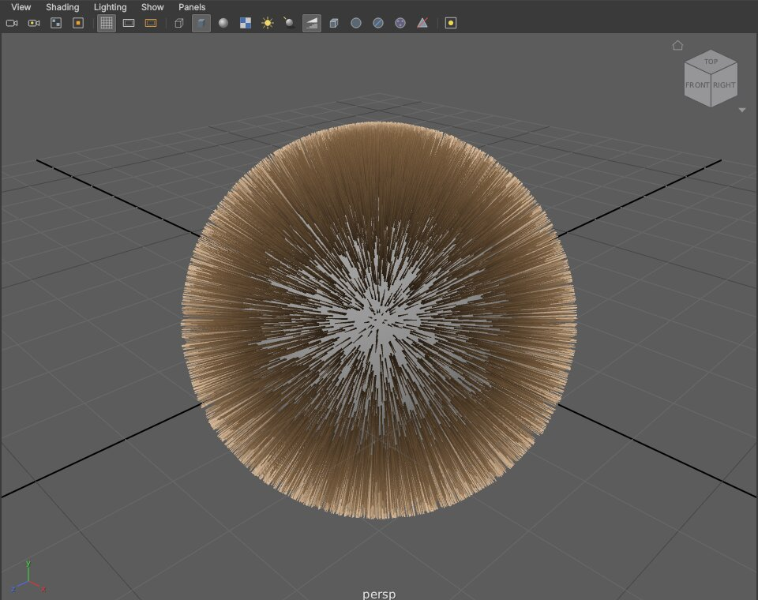

# XJEN

XJEN is Aztek's counterpart of the reference's XGen: hair, fur and feathers grown on meshes, groomed with brushes and
modifiers, drawn in the views and rendered by Harold. It ships as the `xjenToolkit` plug-in (the reference's
`xgenToolkit`), loaded at start. Its node types, commands and Python module keep the reference's names (`xgm*`,
`xgenm`), as Harold keeps the `ai*` node types, so the reference's scenes, presets and scripts load unchanged.

Status, 16/11/2026: steps 1 and 2 are in (strands in Harold and the views; the Interactive Groom core, below); the
rest follows. This page is the target
and the order of work; PARITY.md records what has landed.

## What the reference has

Two systems, both current in the 2027 release.

**Interactive Groom** (the one people groom with today). Spline hair as nodes in the scene, no side files.

- Nodes: `xgmSplineDescription` (the shape, `descriptionShape`), `xgmSplineBase` (`description_base`, generation on the
  bound mesh), and modifiers stacked between them: `xgmModifierSculpt` (sculpt layers), `xgmModifierScale`,
  `xgmCurveToSpline`, `xgmModifierClump`, `xgmModifierCollide`, `xgmModifierCut`, `xgmModifierDisplace`,
  `xgmModifierGuide`, `xgmModifierLinearWire`, `xgmModifierNoise`, `xgmModifierSplineCache`. A new description gets a
  base, a Scale modifier, a Sculpt modifier with one layer and a default hair shader.
- Generation (`description_base`): Density Multiplier, Density Mask (texture or 3D Paint), Interpolate and Interpolate
  From (Current Description or Interp Source, a connection from another description's Output Spline Data), Initial
  Length, CV Count (5 by default, Rebuild), Bound Mesh, density grid Subdivision Level (1 to 5, 3 by default).
- Shape (`descriptionShape`): Width Scale, Taper, Taper Start, Tube Shade (views only), Width Ramp with its
  interpolation; preview settings Highlight Placed Splines, Color, Color Intensity, Draw Control Vertices, CV Size,
  CV Opacity, Render Density Multiplier.
- Create Interactive Groom Splines options: New Description Name, Generator Seed, Density (hairs per face),
  Approximate Spline Count (read only), Length (cm), Width Scale (cm), CV Count.
- Modifiers share Mute, Mask, Magnitude and Magnitude Scale. Clump has Clump Effect (Clump, Clump Scale, Clump
  Volumize, Clump Variance, Preserve Length), Clump Points (Randomness, Density, Density Mask, Seed), Clump Map (Auto
  Update, Radius Variance, Map Subdivision Level, Use Control Map, Control Using, Custom Map, Control Mask, Update
  Clump Map), Advanced Shape (Flatness, Offset, Curl, Orient, Flatness Scale, Offset Scale) and Secondary Effects
  (Copy, Copy Variance, Cut, Noise, Noise Frequency, Noise Correlation, Copy Scale, Noise Scale). Noise has Frequency,
  Correlation, Preserve Length and Live or Baked (to Alembic). Guide has Blend and region maps; Linear Wire has
  Smoothness, Breakage and Reference State; both create guides or wires (10 percent of the hair density by default),
  take selected curves, and can be made dynamic through an nHair system. Curve to Spline takes scene curves or an
  Alembic cache, with Align To Normal.
- Tools (Generate > Interactive Groom Tools, the XGen shelf): Density, Place, Length, Cut, Width, Twist, Comb, Grab,
  Smooth, Noise, Clump, Part, Freeze, Select. Common settings: Size (screen space), Strength, Collide with Meshes (off),
  Collision Distance (cm), Invert Frozen Effect. Keys: B and M drags for size and strength, Ctrl to invert the tool,
  Shift for the alternate action, N to toggle the tool's mode, Ctrl+Shift+I to invert frozen, Ctrl+1 to Ctrl+0 to
  switch tools.
- Interactive Groom Editor: descriptions, their modifier stacks in order, sculpt layers with groups, weights (keyable),
  visibility, Edit, Merge and Merge Visible; Edit, Create, Select (Select Splines on Selected Face, Freeze Selected) and
  Description (Transfer, Preset Export and Import, Cache) menus.
- Commands documented: `xgmSplineQuery` (`-listSplineDescriptions`, `-long`, `-isSplineDescription`, `-splineCount`,
  `-videoMemoryDedicated`, `-videoMemoryUsed`, `-videoMemoryAvailable`), `xgmSplineSelect` (`convertToFreeze`,
  `replaceBySelectedFaces`), `xgmSplineApplyRenderOverride`, `xgmExportSplineDataInternal -output`. The rest of the
  plug-in's commands (the tool contexts, creation, conversion, caching) are not documented and come from the capture
  below.
- Data: the splines leave the description through `outRenderData`, plug-in data a renderer reads as primitives
  (offset and length into per-vertex arrays), positions, widths, texcoords (V from 0 at the root to 1 at the tip) and
  the root's patch UV, with motion samples. The devkit's `XgSplineApi.h` (`XgFnSpline`, `XgItSpline`) reads it.

**XGen** (the original system, still shipped, often called legacy). Collections (palettes) of descriptions whose data
lives in files beside the scene.

- Files: `.xgen` (collection: descriptions, modifiers, patch bindings, guide attributes), `.xdsc` (description),
  `.xgd` (delta), `.xgfx` (modifier), `.xarc` (archive), `.ptex` (maps), `.xpd` (cache per patch), `.xuv` (points),
  `.pda`/`.pdb` (particles), `.xgc` (guide connectivity), all under the project's `xgen` folder with `${DESC}`,
  `${HOME}/xgen`, `${XGEN_ROOT}` and `${XGEN_LOCATION}` paths.
- Primitives (spline, card, sphere, archive), generators, previewers and renderers chosen per description; attributes
  as SeExpr expressions; maps in Ptex.
- Modifiers (FX modules): AnimWires, Groom Bake, Block Anim, Clumping, Coil, Collision, Control Wires, Cut, Force, Mesh
  Cut, Noise, Plane Animation, Particle, Preserve Clumps, Snapshot, Wind.
- Python API `xgenm` (`import xgenm as xg`): creation and deletion, object access (`palettes`, `descriptions`,
  `objects`, `getActive`, `setActive`), attributes (`getAttr`, `setAttr`, `attrs`, custom attributes), FX modules
  (`fxModules`, `addFXModule`, `moveFXModule`), culling, binding, file IO (`importPalette`, `exportPalette`, deltas,
  `importDescription`, `exportDescription`), callbacks, messages, repositories; the Maya extension (guides, patches,
  `modifyFaceBinding`, `bakedGroomManagerBake`); commands `xgmGuideGeom`, `xgmPatchInfo`, `xgmBakeGuideVertices`.
- Generate menu: XGen Editor, XGen Library, Create Description, Import and Export Collections or Descriptions, Export
  Selection as Archive(s), Batch Convert Scene to XGen Archive(s), Convert XGen Primitives to Polygons, Convert to
  Interactive Groom, Import Preset, Export as Preset, then the Interactive Groom items, Cache and Display HUD.

Sources (2027 documentation): [Interactive Groom Editor](https://help.autodesk.com/cloudhelp/2027/ENU/Maya-CharEffEnvBuild/files/GUID-5371B34C-3630-4F65-B6EA-8B99DF73F0B0.htm),
[modifiers](https://help.autodesk.com/cloudhelp/2027/ENU/Maya-CharEffEnvBuild/files/GUID-47E4B5C8-57AE-461F-881F-54F713E8C99D.htm),
[tools](https://help.autodesk.com/cloudhelp/2027/ENU/Maya-CharEffEnvBuild/files/GUID-A00D16BD-9ECC-4C63-BAB5-B0278BF596BB.htm),
[description_base](https://help.autodesk.com/cloudhelp/2027/ENU/Maya-CharEffEnvBuild/files/GUID-B27B8595-D714-4CA6-AEDF-3F08B30E6ED8.htm),
[descriptionShape](https://help.autodesk.com/cloudhelp/2027/ENU/Maya-CharEffEnvBuild/files/GUID-6ED9B961-6DF1-4539-9F64-F69207147CAB.htm),
[creation options](https://help.autodesk.com/cloudhelp/2027/ENU/Maya-CharEffEnvBuild/files/GUID-D25EF979-1444-4DB7-90AD-08A83F5DC6CE.htm),
[MEL commands](https://help.autodesk.com/cloudhelp/2027/ENU/Maya-CharEffEnvBuild/files/GUID-21159091-7F4C-4FAF-BA67-325E15C7A7EE.htm),
[Python API](https://help.autodesk.com/cloudhelp/2027/ENU/Maya-CharEffEnvBuild/files/GUID-33ECC43B-5CF6-4BE1-8EAE-8C6C0D698020.htm),
[files](https://help.autodesk.com/cloudhelp/2027/ENU/Maya-CharEffEnvBuild/files/GUID-E4714F1D-C4F6-49FD-9B89-FDE72CF9296F.htm),
[Generate menu](https://help.autodesk.com/cloudhelp/2027/ENU/Maya-CharEffEnvBuild/files/GUID-DBE2C73E-C8D1-4BEE-B2B7-A7B4ED3B8552.htm),
[hotkeys](https://help.autodesk.com/cloudhelp/2027/ENU/Maya-CharEffEnvBuild/files/GUID-4033B20E-7277-48FA-906A-77F1275B2648.htm),
[spline data in plug-ins](https://blog.autodesk.io/support-xgen-interactive-grooming-feature-in-your-plugin/).

The documentation gives almost no defaults or ranges, and nothing on how the spline data is stored in a scene file.
Those come from the capture.

## Ground truth first

`tools/reference_capture/xgen_capture.py`, run in the reference after making one groom by hand, writes
`tests/data/reference/xgen/`: the plug-in's full command and node type lists (`pluginInfo -c -dn`), every `xgm` node
type's attributes with defaults, the scene saved as `.ma` and `.mb`, `xgmSplineQuery` answers, the spline data dumped
by `xgmExportSplineDataInternal`, and the Script Editor's history with Echo All Commands on, which names the commands
the menus and tools run. Without it, every default and the file layout are guesses; with it, tests read the fixtures.

## Order of work

Each step ends with tests stating the reference's result, the plug-in loading and unloading cleanly, `.ma` and `.mb`
round trips, and screenshots.

1. **Strands in Harold and in the views.** Harold gets a curve primitive (round, ribbon and oriented ribbon, the
   Arnold curve modes, with minimum pixel width), its own BVH leaves for curve segments, motion keys, and the
   `aiStandardHair` shader. The views draw strands as tapered, tube-shaded lines in one GPU buffer per description,
   fast at millions of segments. Both are tested on plain NURBS curves first (the reference renders curves with
   `aiRenderCurve`).
2. **Interactive Groom core.** `xjenToolkit` registers `xgmSplineBase`, `xgmSplineDescription`, `xgmModifierScale` and
   `xgmModifierSculpt`. Create Interactive Groom Splines with its options window; generation on the bound mesh or
   faces (density grid, seed, density, mask, length, width, CV count, interpolation); roots bound by face and UV so
   hair follows a deformed or skinned mesh; `outRenderData`; the descriptionShape's width, taper, ramp and preview
   settings; Display HUD; `xgmSplineQuery`, `xgmSplineSelect`, `xgmExportSplineDataInternal`; save and open in `.ma`
   and `.mb` in the reference's layout. Harold renders it with Render Density Multiplier.
3. **Grooming tools.** The fourteen tools with the common settings, their keys and Tool Settings pages; sculpt layers
   on the Sculpt modifier with weights, keys, groups, Merge and Merge Visible; freezing; undo per stroke.
4. **Modifiers.** Clump with its clump map, Noise (Live; Baked waits for step 6), Cut, Collide, Displace, Guide and
   Linear Wire with region maps, Curve to Spline. Masks, Magnitude and Magnitude Scale on all.
5. **Editor and the rest of the menu.** The Interactive Groom Editor, the XGen shelf, presets (export and import),
   Transfer, Convert Interactive Groom to Polygons, Select Splines on Selected Face.
6. **Alembic** (PLAN 4.2), then the Cache menu, Spline Cache, Noise baked, Curve to Spline from a cache.
7. **XGen (collections).** `.xgen` and `.xdsc` read and written, primitives, generators, guides, the sixteen FX modules,
   SeExpr expressions, Ptex maps, archives, the XGen Editor and Library, the `xgenm` Python API, Convert to
   Interactive Groom. Needs an expression language and a Ptex reader; both have permissive licences (SeExpr Apache
   2.0, Ptex BSD) and are to be checked before they are taken.
8. **Dynamics.** Make Guides and Wires Dynamic once the unified solver simulates hair (`hairSystem` is held, not
   simulated, today; see docs/DYNAMICS.md).

## Step 2 as built (16/11/2026)

- Node types `xgmSplineBase`, `xgmModifierScale`, `xgmModifierSculpt` and the shape `xgmSplineDescription`, registered
  at start so files open with or without the plug-in; `xjenToolkit` (also answering to `xgenToolkit`) adds the
  commands and puts descriptions in the views and Harold. Splines pass base, Scale, Sculpt, shape through
  `outSplineData` into `inSplineData`; the shape's `outRenderData` carries them with widths.
- Generation: per face, Density x Density Multiplier splines (the fraction as a chance), placed by UV area within the
  face, drawn from Generator Seed and the face number only, so roots stay put as the mesh moves, deforms or is
  skinned; straight along the smoothed normal for Initial Length, CV Count points. Bound to a mesh or to faces
  (`boundFaces`).
- Scale: about the root, by 1 + (Scale - 1) x Magnitude x Magnitude Scale. Sculpt: layers (`layer[i].layerName`,
  keyable `layerWeight`, `layerVisibility`, `layerGroup`) of moves in each root's frame, so they ride the surface;
  the moves are kept as plug-in data (`xjenSculptData`) and written in `.ma` as text. Mute on both.
- Shape: Width Scale, Width Ramp, Taper, Taper Start; Color and Color Intensity for the views; Render Density
  Multiplier thins what Harold renders (the views show every spline); `aiMode` ribbon or thick; shading group
  membership as a mesh's, a new description getting its own `aiStandardHair`.
- Commands: `xjenCreateGroom` (Generate > Create Interactive Groom Splines, with its option box: name, seed, density,
  length, width scale, CV count; on selected meshes or faces) and `xgmSplineQuery` (`-listSplineDescriptions`,
  `-long`, `-isSplineDescription`, `-splineCount`).
- Not yet, and why: the reference's creation command and attribute file names (undocumented: from the capture);
  `.mb` keeps the groom but not the sculpt moves (plug-in data has no binary layout here yet); Density Mask, Subdivision
  Level, Interpolate and the modifiers' Mask are kept and not applied; Render Density Multiplier above 1;
  Highlight Placed Splines, Tube Shade, Draw Control Vertices in the views; Display HUD; `xgmSplineSelect` and
  `xgmExportSplineDataInternal` wait for step 3's selection of splines.

The aim beyond parity, kept for after it: views that draw hair as Harold renders it.
